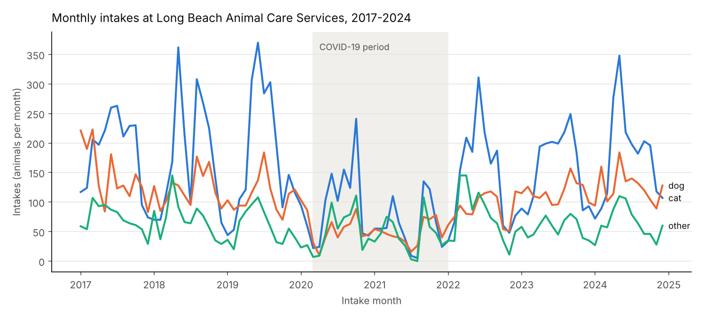
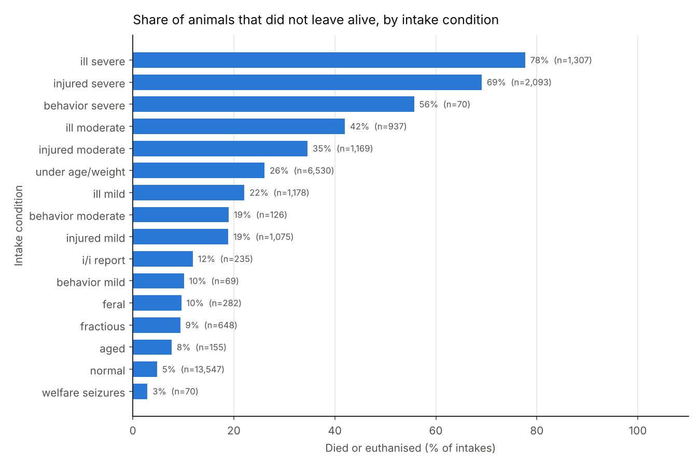
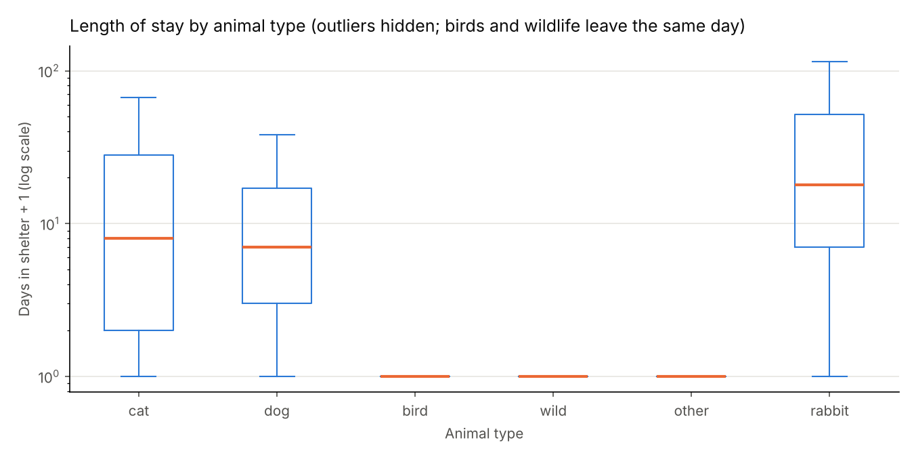
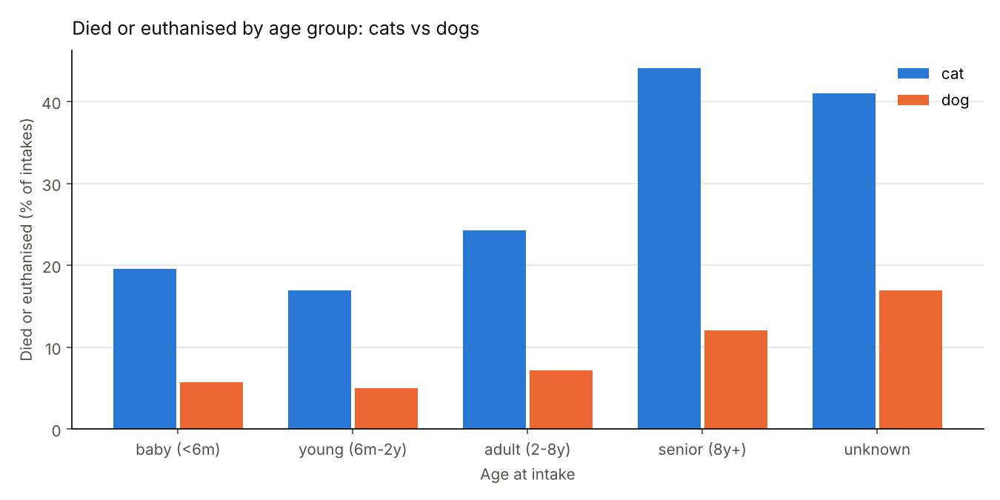
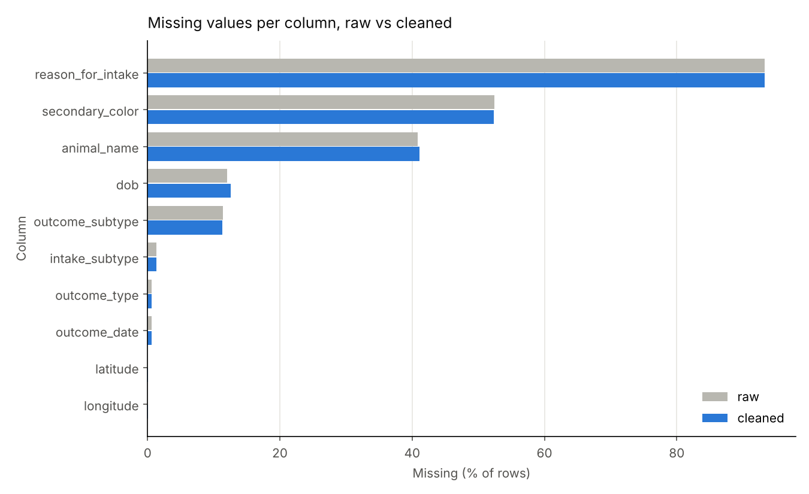
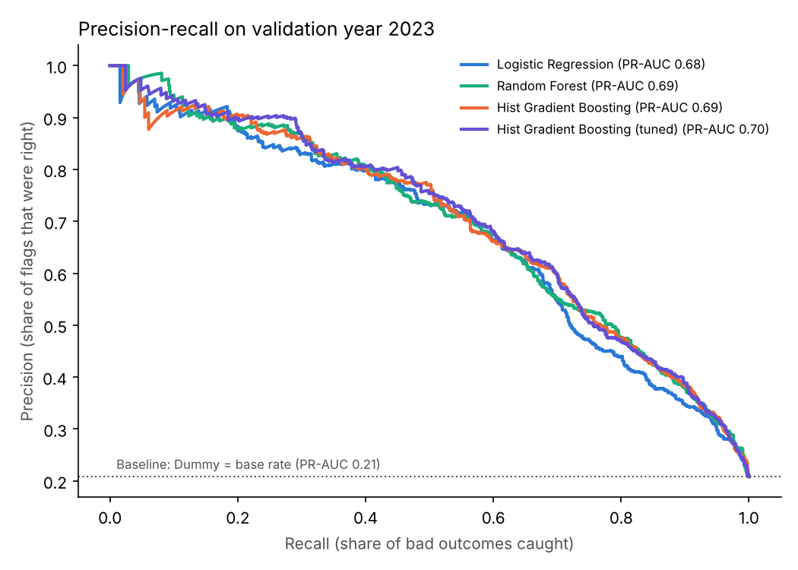
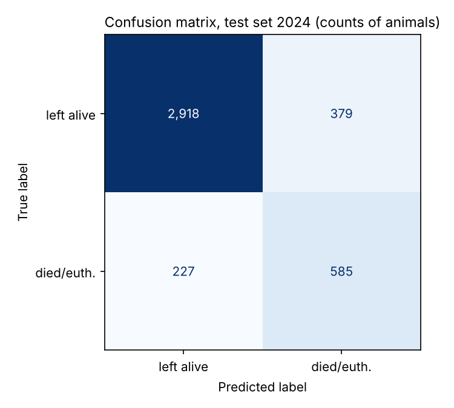
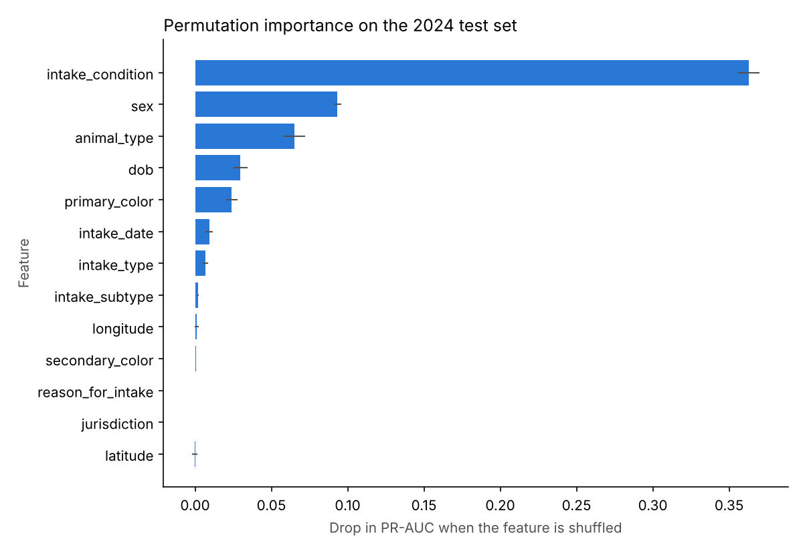

# Long Beach Animal Shelter - Reproducible Data Pipeline & Tabular ML

**Muhammad Twaib · Roll No TRN-2026-000353 · Assignment 2 (Reproducible Data Pipelines, Tabular ML & Systems Exploration)**

One real, messy, public dataset → a tested data-quality pipeline (Part A) → a leakage-checked ML model that flags animals at risk at intake (Part B) → four engineering explorations (Part C).

---

## 1. Quick start (fresh clone)

```bash
git clone <this-repo-url> && cd project
python -m venv .venv
source .venv/bin/activate            # Windows: .venv\Scripts\activate
pip install -r requirements.txt      # Python 3.11+ (tested on 3.13)

python run_all.py                    # everything: Part A, Part B, predictions, tests, C1 (~2 min)
```

Or step by step:

| Step | Command | Writes |
|---|---|---|
| Check raw file (downloads it if missing, verifies SHA-256) | `python -m src.download_data` | `data/raw/` |
| **Part A** pipeline | `python -m src.pipeline_a` | `data/cleaned/`, `outputs/figures/01-05`, `outputs/reports/` incl. `metrics.json` |
| Quality-gate demo (bonus A) | `python -m src.make_corrupted` then `python -m src.pipeline_a --input data/corrupted/shelter_corrupted.csv --metrics-out outputs/reports/gate_demo/metrics_corrupted.json` | exits with code 1 and a clear error |
| **Part B** training | `python -m src.train` | `models/outcome_pipeline.joblib`, `outputs/figures/06-08`, `outputs/reports/model_comparison.csv` … |
| Score new rows (bonus B) | `python -m src.predict data/new/unseen_intakes.csv` | `data/new/unseen_intakes_predictions.csv` |
| Compare with real outcomes | `python -m src.evaluate_unseen` | `outputs/reports/unseen_rows_scores.json` |
| Tests / lint | `pytest -q` · `ruff check src tests exploration` | 36 tests |
| **C1** feed experiment | `python exploration/c1_feed/feed_experiment.py` | `exploration/c1_feed/results.md` |

The raw file is never written to. Everything else can be deleted and rebuilt with the commands above.

## 2. Dataset (Checkpoint 0 proposal)

| | |
|---|---|
| **Name** | Animal Shelter Intakes and Outcomes - City of Long Beach Animal Care Services |
| **Source (official)** | City of Long Beach Open Data portal - https://data.longbeach.gov/explore/dataset/animal-shelter-intakes-and-outcomes |
| **Copy used** | Unmodified portal export kept in `EmilHvitfeldt/animalshelter`, `data-raw/animal-shelter-intakes-and-outcomes.csv`, pinned to commit `1bd593f`, SHA-256 `3228dd3a…e528f1` (URL in `src/config.py`). Our sandbox could not reach the portal directly, so the pinned mirror makes the download reproducible. |
| **Licence** | Public open data published by the City of Long Beach for public use; the mirror repository is MIT-licensed. *Check the exact terms on the portal's "Information" tab before reuse.* |
| **Accessed** | 20 November 2026 |
| **Size** | 29,787 rows × 23 columns; intakes 2017-01-01 … 2024-12-31 |
| **Types** | numeric (lat/lon), categorical (type, sex, condition, intake/outcome type…), dates (DOB, intake, outcome), free text (name, address) |
| **Quality problems** | 12,162 missing names, 3,591 missing DOBs + 149 DOBs *after* intake, 43 duplicate stays + 31 rows with outcome "DUPLICATE", 8 coordinates in Hawaii/Oregon/New York, typos (`ILL MODERATETE`, `Euthenasia`), double spaces, colour abbreviations, `DISTRICT1-9` vs `LONG BEACH`, a label column that calls "disposal" alive |
| **Target (Part B)** | `bad_outcome` - did the animal **not** leave alive (euthanised / died)? ~21% positive |
| **Why useful** | Predicted at intake, it lets staff send at-risk animals to the vet or to rescue partners first - shelters have limited vet time. |
| **Why it fits** | Operational government data, not a competition file; > 5,000 rows, > 8 mixed-type columns, measurable quality problems, clear target. |

Full schema with types, units, allowed values and missing counts: **`docs/schema.md`**.

## 3. Repository layout

```
project/
├── README.md               this file
├── requirements.txt        pinned dependencies
├── run_all.py              one command for everything
├── data/raw/               original CSV (never edited)
├── data/cleaned/           pipeline output (shelter_clean.csv, shelter_rejected.csv, shelter.db*)
├── data/new/               unseen rows + hand-made rows for predict.py
├── src/                    config, cleaning, validation, analysis, pipeline_a, features, train, predict …
├── notebooks/              scratch exploration only
├── tests/                  36 pytest tests
├── outputs/figures/        8 PNG charts
├── outputs/reports/        data-quality report, metrics.json, model comparison, error analysis …
├── models/                 outcome_pipeline.joblib
├── sql/                    outcome_by_intake_type.sql
├── exploration/c1_feed/    Part C1 experiment + results
├── docs/                   schema.md, assumptions.md (incl. model card), exploration.md, review_checklist.md
└── .github/                workflows/ci.yml, pull_request_template.md, CODEOWNERS
```
`*` regenerated, not committed.

---

## 4. Part A - Data quality & insights

**Pipeline** (`src/pipeline_a.py`): load raw as text → measure "before" → clean (`src/cleaning.py`, 13 functions) → validate (`src/validation.py`, 15 checks: not-null, unique, regex, allowed values, ranges, date order, dtypes) → **quality gate** → save → summaries, charts, SQL.

### Data-quality metrics (`outputs/reports/data_quality_report.md`, `metrics.json`)

| Metric | Raw | Clean |
|---|---|---|
| Rows | 29,787 | 29,737 |
| Validation row pass rate | 0.00% (categories not standardised) | **100.00%** |
| Checks fully passed | 7 / 14 | 15 / 15 |
| Duplicate rows removed | - | 50 (0.17%) → `shelter_rejected.csv` |
| Impossible values blanked | - | 149 DOBs, 8 coordinate pairs |
| Rows without a usable label | - | 245 |

**Quality gate (bonus A):** the pipeline stops if the row pass rate is below **95%** or a critical check (null ID / intake date, wrong dtypes) fails, and writes `metrics.json` every run. On a deliberately corrupted copy (10% of rows: animal type `DRAGON`, outcome before intake, bad IDs) it fails with
`QUALITY GATE FAILED: row pass rate 90.61% (threshold 95%) … worst checks: allowed:animal_type 993, order:intake_date<=outcome_date 991, pattern:animal_id 790` and exit code 1; on the real data it passes. Logs: `outputs/reports/gate_demo/`.

### Pandas / NumPy
`groupby().agg` (per animal type and intake condition), `pivot_table` (intakes per year × type), `value_counts` (outcomes). NumPy vectorised: `np.select` (age groups), haversine distance with `np.radians/np.sin/np.arcsin`, `np.clip` (stay length), `np.where` (label), `np.nanpercentile` (stay percentiles). Tables in `outputs/reports/summary_*.csv`.

### Charts (`outputs/figures/`)

| Figure | What it shows |
|---|---|
|  | **Intakes fell by more than half in 2020-21 (COVID) and returned to pre-COVID levels by 2024; cat intakes peak every spring-summer ("kitten season").** |
|  | **Intake condition is the strongest signal: 78% of animals arriving "ill severe" and 69% "injured severe" did not leave alive, versus 5% of "normal" animals.** |
|  | **Cats and dogs stay about a week (median 7 and 6 days), rabbits 17 days, while birds and wildlife are processed the same day.** |
|  | **Cats have a much higher bad-outcome rate than dogs at every age, and seniors (8 y+) and animals with unknown age are most at risk.** |
|  | **Missing values barely change after cleaning - by design: real gaps are documented, not filled, and impossible values are turned into missing.** |

### SQLite (`sql/outcome_by_intake_type.sql`)
The cleaned table is loaded into `data/cleaned/shelter.db` with a small lookup table that groups 12 intake types into 4 groups; the query **joins** them and **groups**:

```sql
SELECT l.intake_group, COUNT(*) AS intakes,
       ROUND(100.0 * AVG(i.bad_outcome), 1) AS pct_died_or_euthanised,
       ROUND(AVG(i.length_of_stay_days), 1) AS avg_stay_days
FROM intakes AS i JOIN intake_type_lookup AS l ON i.intake_type = l.intake_type
WHERE i.bad_outcome IS NOT NULL
GROUP BY l.intake_group ORDER BY pct_died_or_euthanised DESC;
```

| intake_group | intakes | % died or euthanised | avg stay (days) |
|---|---|---|---|
| wildlife | 4,466 | 50.9 | 0.3 |
| found / stray | 20,957 | 16.9 | 20.5 |
| owner gave up | 2,904 | 12.9 | 30.2 |
| legal / enforcement | 1,165 | 8.1 | 21.5 |

**Meaning:** half of wildlife intakes end in euthanasia within hours (injured wild animals that cannot be released), while animals surrendered by owners have a lower bad-outcome rate but the longest stays - they use the most kennel-days.

Assumptions, what was **not** fixed and why, and limitations: **`docs/assumptions.md`**.

---

## 5. Part B - Tabular ML baseline

* **Problem:** binary classification - at intake, will the animal **not** leave alive? Positive class ≈ 20%.
* **User:** intake staff / shelter vet, to prioritise vet checks and rescue calls.
* **Leakage excluded:** outcome type/subtype/date, length of stay, `outcome_is_dead`, `was_outcome_alive` - and two less obvious ones found by leak checks: **animal name** (shelter gives names when an animal goes up for adoption) and **neutered/spayed status** (animals are sterilised before adoption). Adding either one makes validation PR-AUC jump (0.70 → 0.78 / 0.76) - too good to be true at intake.
* **Split - time-based, done before any fitting:** train 2017-2022 (21,302) · validation 2023 (3,976) · test 1 Jan - 14 Dec 2024 (4,109, used once) · unseen 15-31 Dec 2024 (105, only for `predict.py`). *Why time-based:* the model will score **future** intakes; a random split would let 2024 animals help predict 2019 ones and hide drift (COVID, policy changes). Inside train: `TimeSeriesSplit(5)`.
* **Pipeline (one object):** `FunctionTransformer(build_features)` → `ColumnTransformer` (median imputation + scaling for numbers; constant imputation + one-hot with rare-category grouping for categories) → model. All imputers/encoders are fitted on training rows only.
* **Metric choice:** with 80/20 classes, accuracy is misleading (always "alive" = 80%). Main metric **PR-AUC**; also recall (missed at-risk animals are the costly error), precision (each flag costs staff time), F1 and ROC-AUC. Threshold chosen on the 2023 validation year (max F1 → 0.657).

### Model comparison (`outputs/reports/model_comparison.csv`, same split + metrics for all)

| Model | CV PR-AUC (train, 5 folds) | CV ROC-AUC | Val PR-AUC 2023 | Val ROC-AUC | Val recall | Val precision |
|---|---|---|---|---|---|---|
| Baseline: Dummy (prior) | 0.217 ± 0.038 | 0.500 | 0.208 | 0.500 | 0.000 | 0.000 |
| Logistic Regression | 0.676 ± 0.041 | 0.865 ± 0.019 | 0.678 | 0.857 | 0.764 | 0.457 |
| Random Forest | 0.693 ± 0.037 | 0.871 ± 0.020 | 0.694 | 0.870 | 0.772 | 0.510 |
| Hist Gradient Boosting | 0.688 ± 0.040 | 0.867 ± 0.027 | 0.694 | 0.871 | 0.772 | 0.498 |
| **HGB tuned** (grid on train: lr 0.05, 31 leaves, l2 1.0) | 0.700 (best of grid) | - | **0.701** | 0.872 | 0.777 | 0.482 |
| *Leak check: HGB + has_name (not used)* | - | - | 0.775 | 0.902 | 0.797 | 0.595 |
| *Leak check: HGB + is_altered (not used)* | - | - | 0.755 | 0.910 | 0.829 | 0.547 |

**Final test (2024, used once):** PR-AUC **0.721** (dummy 0.198) · ROC-AUC 0.880 · recall 0.720 · precision 0.607 · F1 0.659. On the 105 never-seen rows scored by `predict.py`: PR-AUC 0.754, recall 0.87, precision 0.74.

 

### Error analysis (`outputs/reports/error_examples.csv`, `subgroup_performance.csv`)
1. **Dogs that look healthy at intake but are euthanised for behaviour** - every one of the most confident misses is a dog with condition `normal` and outcome subtype `beh severe` / `at vet`. Recall for dogs is only 0.31 (cats 0.76).
2. **Animals that become ill in the shelter** - the largest group of misses ends `ill severe` though they arrived `normal`; intake data cannot see this.
3. **Over-flagging sick wildlife and "other" animals that were in fact transferred or rescued** - wildlife recall 1.00 but precision 0.58.
4. Small groups (`return`, `quarantine`, `welfare seized`) have too few positives for stable metrics.

**Most important features (bonus B, permutation importance on 2024):** *intake condition* matters far more than anything else, followed by sex, animal type and age (DOB) - this makes sense, because severe illness/injury and being wildlife are exactly what drives euthanasia decisions; the weight on `sex` (mainly "unknown") is flagged as a possible remaining leak in the model card.


**`predict.py` (bonus B):** `python -m src.predict new_rows.csv [--output out.csv]` loads the saved pipeline, checks the 13 required columns and the intake dates (lists every problem, exit code 2), and writes `risk_probability` + `high_risk_flag`. Unknown categories (e.g. colour "purple polka dot") are handled. See `data/new/handmade_intakes_predictions.csv`.

Model card (intended use, assumptions, limitations, risks): **`docs/assumptions.md`**.

---

## 6. Part C - Exploration

Write-ups in **`docs/exploration.md`**. Artifacts:
* **C1** `exploration/c1_feed/feed_experiment.py` - feed query on 300k posts: **47.6 ms → 0.07 ms** with an index on `posts(author_id, created_at)` (EXPLAIN QUERY PLAN changes from `SCAN p` to `SEARCH p USING INDEX`); **bonus** ranker (likes + recency decay) 12.5 → 0.29 ms with the index and 0.011 ms from a 60-s cache. Results: `exploration/c1_feed/results.md`.
* **C2** `.github/workflows/ci.yml` (ruff + pytest + pipeline smoke tests on every PR), `.github/pull_request_template.md`, `.github/CODEOWNERS`, `docs/review_checklist.md`.
* **C3** glossary of 10 terms + consistency-vs-availability trade-off.
* **C4** design workflow + one-page design doc for an "Intake Risk Score" service.

---

## 7. Tools used (academic-integrity statement)

Python, pandas, NumPy, scikit-learn, Matplotlib, SQLite, pytest, ruff, Git/GitHub Actions.
**AI assistant:** Claude (Anthropic) was used to help write and explain code and documentation for this project. I have gone through every file and can explain each line and decision (split, metric, cleaning rules, leak checks) in the demo.
